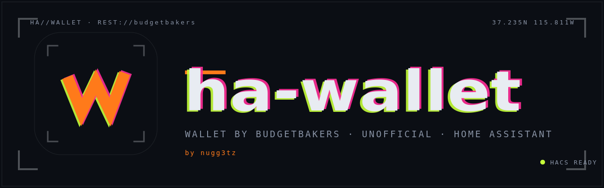
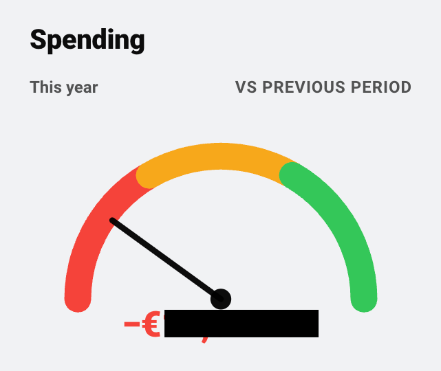
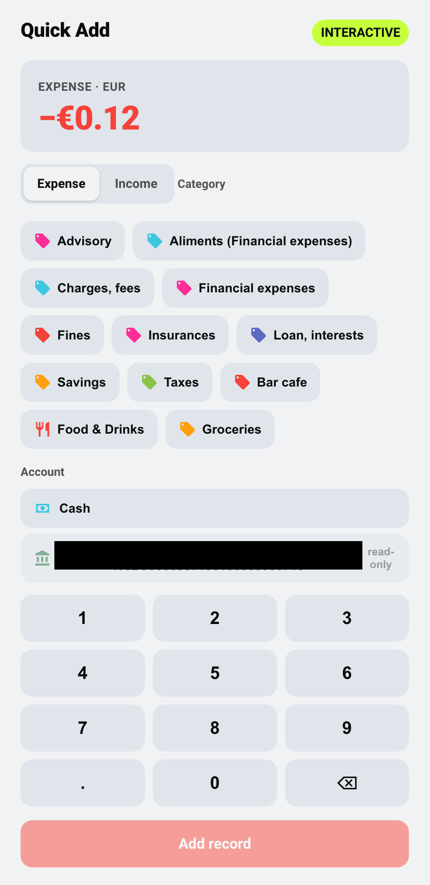

<p align="center">
  
</p>

# Wallet by BudgetBakers — Home Assistant integration

[![hacs][hacs-badge]][hacs-url]
[![license][license-badge]](LICENSE)

Bring your **[Wallet by BudgetBakers][wallet]** finances into Home Assistant over
the **official Wallet REST API** — see balances, budgets and spending as
entities, and log cash expenses from a home wall panel straight back into the
Wallet app.

> **Unofficial / not affiliated.** This is a community integration. It is not
> made by, endorsed by, or affiliated with BudgetBakers. "Wallet by
> BudgetBakers" is used only to describe what the integration connects to.

## Why this integration

- **Bidirectional & app-synced** — the only Home Assistant finance integration
  that both reads *and* writes to a real mobile app you already use. Others are
  read-only mirrors or local-only tools.
- **Private by design** — runs locally, your token stays on your instance, and
  bank-synced accounts are read-only. Nothing is sent to a third party.
- **Multi-currency & i18n from day one** — currency is inherited from Wallet per
  account, never hardcoded; strings are translatable.

## Requirements

- A **Wallet Premium** plan and a **Bearer token** from the Wallet web app
  (Settings → API). The token maps to one Wallet account.
- Home Assistant **2025.6** or newer.

The Premium requirement is inherent to the official API — this integration is
built on the supported API rather than a fragile email/notification hack.

## Installation (HACS)

[](https://my.home-assistant.io/redirect/hacs_repository/?owner=nuggetz&repository=ha-wallet&category=integration)

1. Open HACS, search for **Wallet by BudgetBakers** and download it (or use the
   button above).
2. Restart Home Assistant.
3. Add the integration and paste your API token:

   [](https://my.home-assistant.io/redirect/config_flow_start/?domain=ha_wallet)

   or go to **Settings → Devices & Services → Add Integration** and search for
   **Wallet by BudgetBakers**.
4. Use the integration's **Configure** button to pick which accounts to expose
   and the reporting period.

> If your token is later rejected, Home Assistant will prompt you to
> **re-authenticate** — just paste a fresh token.

### Manual installation

Only needed if you don't run HACS: copy `custom_components/ha_wallet/` from the
[latest release](https://github.com/nuggetz/ha-wallet/releases/latest) into your
`config/custom_components/` folder, restart Home Assistant and continue from step 3
above. The dashboard cards are included in that folder.

## Privacy & data handling

- The token is stored in Home Assistant's encrypted config entry and **never
  logged**.
- Bank-synced accounts are **read-only** by API design; the integration can only
  write to cash/manual accounts.

## Entities

All entities live on a single **Wallet by BudgetBakers** service device. Account,
balance, budget and goal sensors are created **one per object in your Wallet**, so
the exact count depends on your setup; the rest are singletons. Entities that
appear after you create an object via a service show up **without a restart**.

Monetary sensors carry `device_class: monetary`. Sensors whose state is a count
expose the detail in attributes — including the **object ids** the services need,
which is how you discover them from the UI.

| Entity | State | Key attributes |
|---|---|---|
| `sensor.wallet_by_budgetbakers_account_<name>` | account balance | `account_id`, `account_type`, `currency`, `bank_synced`, `last_change` |
| `sensor.wallet_by_budgetbakers_balance_<currency>` | total balance in that currency | `account_ids`, `currency` |
| `sensor.wallet_by_budgetbakers_cash_flow` | net (income − expense) for the period | `income`, `expense`, `currency`, `vs_previous_pct`, `period` |
| `sensor.wallet_by_budgetbakers_spending` | total expense for the period | `vs_previous_pct`, `by_category`, `currency`, `period` |
| `sensor.wallet_by_budgetbakers_spending_by_nature` | total expense for the period | `must`, `need`, `want`, `currency`, `period` |
| `sensor.wallet_by_budgetbakers_budget_<name>` | amount spent against the budget | `budget_id`, `limit`, `remaining`, `period`, `category_ids`, `currency` |
| `sensor.wallet_by_budgetbakers_last_records` | count of recent records | `records` (list incl. **record id**, amount, category, account, date, note) |
| `sensor.wallet_by_budgetbakers_credit_utilization` | used credit (best-effort, may be `unknown`) | `credit_balance`, `total_credit_limit`, `available` |
| `sensor.wallet_by_budgetbakers_goal_<name>` | goal target amount | `goal_state`, `desired_date`, `initial_amount`, `currency` |
| `sensor.wallet_by_budgetbakers_standing_orders` | count of standing orders | `orders` (list incl. **standing order id**, name, amount, due date) |
| `sensor.wallet_by_budgetbakers_record_rules` | count of record rules | `rules` (list incl. **rule id**, name, keywords, category) |
| `sensor.wallet_by_budgetbakers_categories` | count of categories | `categories` (list incl. **category id**, name, custom, parent, cardinality) |
| `sensor.wallet_by_budgetbakers_labels` | count of labels | `labels` (list incl. **label id**, name, archived) |
| `sensor.wallet_by_budgetbakers_api_requests_remaining` | requests left this hour | `limit`, `reset_at` |

The last four are **diagnostic** entities: their job is to make ids readable so you
can pass them to the services below.

Aggregates cover every record state **except `void`**. Totals are reported in the
account's native currency when a single currency is involved, and in your Wallet
profile's base currency when several are mixed.

## Services

> **Permissions.** Services that delete data, move money between accounts or
> change your Wallet structure (`delete_record`, `add_transfer`,
> `delete_standing_order`, `delete_record_rule` and the four `manage_*`) are
> registered as **admin-only** — a shared wall panel is exactly the place where a
> non-admin user reaches the service registry. `add_record` and `update_record`
> stay available to every user, since logging a cash expense is the point.

### `ha_wallet.add_record`

Create an expense or income on a **cash/manual** account. The **amount sign**
selects the type — negative = expense, positive = income (never zero) — and the
**currency is inherited from the account** (never sent). Writes to bank-synced
accounts are rejected with a clear error.

| Field | Required | Notes |
|---|---|---|
| `account_id` | ✅ | A cash/manual account id (bank-synced accounts are read-only). |
| `amount` | ✅ | Non-zero. Negative = expense, positive = income. |
| `payment_type` | ✅ | `cash`, `debit_card`, `credit_card`, `transfer`, `voucher`, `mobile_payment`, `web_payment`. |
| `category_id` | | Optional category id. |
| `record_date` | | Optional date/time (defaults to now; not >24 h in the future). |
| `note` | | Optional free text. |
| `label_ids` | | Optional list of label ids. |

```yaml
service: ha_wallet.add_record
data:
  account_id: "3f8e2a6b-9c4d-4e1f-b2a7-5d8c3e9f1a4b"
  amount: -12.50          # €12.50 expense
  payment_type: cash
  note: "Coffee"
```

### `ha_wallet.update_record`

Patch an existing record — only the fields you pass change. Amount keeps the
signed convention (negative = expense, positive = income).

```yaml
service: ha_wallet.update_record
data:
  record_id: "7c2b9d4e-1f3a-4b5c-8e6d-2a7f9b3c1e5a"
  category_id: "5c5c03e8-..."
  note: "Reclassified"
```

### `ha_wallet.delete_record`

Delete a record. By default the call is **blocked if other entities reference
it** (a references pre-check); pass `force: true` to delete anyway.

```yaml
service: ha_wallet.delete_record
data:
  record_id: "7c2b9d4e-1f3a-4b5c-8e6d-2a7f9b3c1e5a"
  # force: true
```

### `ha_wallet.add_transfer`

Move money between two of your accounts. `amount` is the positive magnitude to
move from source to target; with pairing mode `new` the integration creates the
linked mirror on the target account. Bank-synced accounts are read-only.

```yaml
service: ha_wallet.add_transfer
data:
  from_account_id: "acc-cash"
  to_account_id: "acc-savings"
  amount: 100
  pairing_mode: new
```

### Management services (`manage_*`)

Four services manage your Wallet setup; each takes an `operation`
(`create` / `patch` / `delete`):

| Service | Operations | Notes |
|---|---|---|
| `ha_wallet.manage_budget` | create / patch / delete | Create needs `name`, `currency_code`, `type`, `limit`. |
| `ha_wallet.manage_category` | create / patch / delete | Create makes a **custom subcategory** (`name` + `parent_id`). Only custom categories delete. |
| `ha_wallet.manage_account` | create / patch | Cash/manual types only. **No delete** in this version. |
| `ha_wallet.manage_label` | create / patch | **No delete** in this version. Apply labels via `label_ids` on records. |

```yaml
service: ha_wallet.manage_budget
data:
  operation: create
  name: "Groceries"
  currency_code: EUR
  type: BUDGET_INTERVAL_MONTH
  limit: 300
  category_ids: ["5c5c03e8-..."]
```

Colours use Wallet's named palette (e.g. `Blue`, `Green`, `Orange`).

### Advanced delete services

- `ha_wallet.delete_standing_order` — delete a recurring standing order by
  `standing_order_id`.
- `ha_wallet.delete_record_rule` — delete an auto-categorisation rule by
  `record_rule_id`.

### Wall-panel quick add

A ready-made helper package (amount / expense-income / payment type / note plus
a one-tap script) lives in [`examples/wall-panel-package.yaml`](examples/wall-panel-package.yaml).
Drop it into your `packages/` folder, point it at a cash account id, and add the
Lovelace card shown at the bottom of that file. For a ready-made keypad, use the
bundled `wallet-quick-add-card` (see [Dashboard cards](#dashboard-cards)).

## Dashboard cards

The integration ships a set of 21 Lovelace cards that reproduce the Wallet web
dashboard as native, theme-aware Home Assistant cards. **Nothing to install
separately:** once the integration is set up, the cards are loaded on every
dashboard (storage and YAML mode) and appear in the card picker under
*Wallet · …*. After an upgrade, reload the browser once.

<p align="center">
  
  &nbsp;
  
  &nbsp;
  
</p>

> **Upgrading from the standalone `ha-wallet-card` plugin?** The cards now live
> here, and the separate repository is archived. Remove **Wallet by BudgetBakers
> Cards** from HACS (or delete the `/hacsfiles/ha-wallet-card/ha-wallet-card.js`
> or `/local/ha-wallet-card.js` dashboard resource), then reload the browser.
> Card types are unchanged, so existing dashboards keep working.

Every card is theme-aware (light/dark, HA theme variables) and ships four states:
**default**, **empty**, **loading** (skeleton) and **error** (stale badge / can't-reach hint).

### Analytic (12)

| Card type | Reads |
|---|---|
| `wallet-cash-flow-card` | `sensor.wallet_by_budgetbakers_cash_flow` |
| `wallet-cash-flow-trend-card` | history/LTS of `…_cash_flow` |
| `wallet-spending-card` | `…_spending` (gauge) |
| `wallet-nature-of-spending-card` | `…_spending_by_cardinality` |
| `wallet-balance-by-currencies-card` | `…_balance_<currency>` (all) |
| `wallet-spending-by-categories-card` | `…_spending` → `by_category` |
| `wallet-credit-limits-card` | `…_credit_utilization` |
| `wallet-balance-trend-card` | history/LTS of `…_balance_<currency>` |
| `wallet-expenses-structure-card` | `…_spending` → `by_category` (donut) |
| `wallet-period-comparison-card` | history/LTS of `…_cash_flow` |
| `wallet-last-records-card` | `…_last_records` → `records` |
| `wallet-accounts-card` | `…_account_<name>` (all) |

### Quick entry (1)

| Card type | Calls |
|---|---|
| `wallet-quick-add-card` | `ha_wallet.add_record` (keypad, category chips, account picker) |

### Action / write-side (8)

| Card type | Calls |
|---|---|
| `wallet-records-action-card` | `add_record` / `update_record` / `delete_record` |
| `wallet-transfer-card` | `add_transfer` |
| `wallet-budgets-action-card` | `manage_budget` |
| `wallet-categories-action-card` | `manage_category` |
| `wallet-accounts-action-card` | `manage_account` (create/patch) |
| `wallet-labels-action-card` | `manage_label` (create/patch) |
| `wallet-automations-action-card` | `delete_standing_order` / `delete_record_rule` |
| `wallet-import-history-card` | `ha_wallet.import_history`, **only shown if the service exists** (deferred to 0.1.x) |

Write cards that call an admin-only service (see [Services](#services)) only work
for admin users.

### Usage

Each card auto-discovers its entity from the Wallet device, or you can pin it:

```yaml
# Auto-discovers the cash-flow sensor from the Wallet device
type: custom:wallet-cash-flow-card

# Or bind an explicit entity / title
type: custom:wallet-spending-card
entity: sensor.wallet_by_budgetbakers_spending
title: Spending
```

The Quick-Add and action cards need no entity. They enumerate accounts, categories
and labels from the device and call services:

```yaml
type: custom:wallet-quick-add-card
```

Bank-synced accounts are read-only: the write cards block record creation, edit and
delete on them and surface the integration's error inline. Trends read Home
Assistant long-term statistics, so a fresh install fills from install date forward.

### Building the cards

The TypeScript source lives in [`frontend/`](frontend/); the built bundle is
committed at `custom_components/ha_wallet/www/ha-wallet-card.js`.

```bash
cd frontend
npm ci
npm run lint      # tsc --noEmit
npm run build     # src/ → ../custom_components/ha_wallet/www/ha-wallet-card.js
```

## Development status

This is an early build. Milestones ship internally; the **first public release
is `0.1.0`**, cut once the full v1 API surface is complete.

| Milestone | Scope | Status |
|---|---|---|
| **M0** | Config flow (secure token), rate-limit-aware coordinator, init-sync handling, i18n + multi-currency base | ✅ Done |
| **M1** | Read sensors (balances, budgets, spending, records) + overspending blueprint | ✅ Done |
| **M2** | Cash entry service (`add_record`) + wall-panel button recipe | ✅ Done |
| **M3** | Extended record write (`update_record`, `delete_record` with references pre-check, `add_transfer`) | ✅ Done |
| **M4** | Management: `manage_budget` / `manage_category` / `manage_account` / `manage_label` (account & label delete excluded in v1) | ✅ Done |
| **M5** | Goals / standing-orders / record-rules sensors + delete services, API-usage diagnostic sensor | ✅ Done |
| 0.1.x | Optional CSV `import_history` (LTS trend seeding) — deferred until validated | 🔮 Later |
| 0.2.0 | Household / multi-account (multiple tokens) | 🔮 Future |

## License

[MIT](LICENSE) © nugg3tz

[wallet]: https://budgetbakers.com/
[hacs-badge]: https://img.shields.io/badge/HACS-Default-41BDF5.svg
[hacs-url]: https://github.com/hacs/default
[license-badge]: https://img.shields.io/badge/license-MIT-blue.svg
